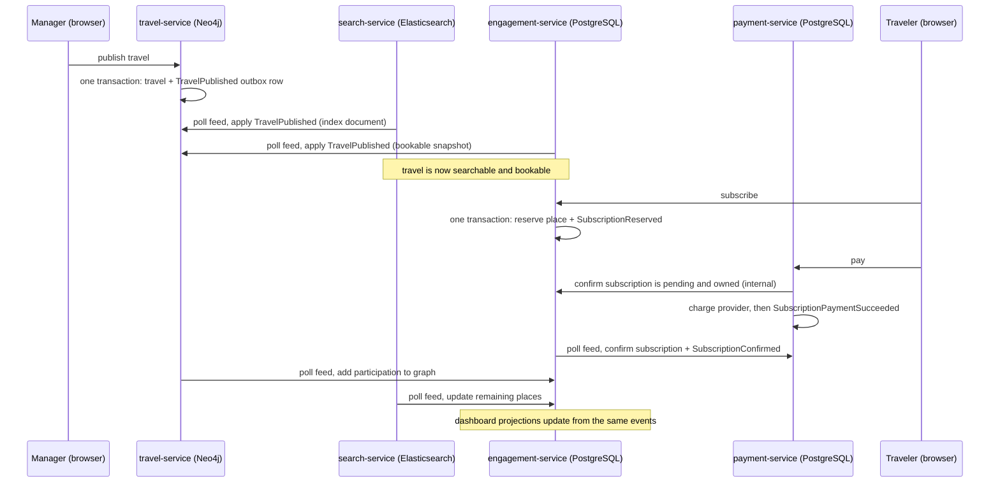

# Architecture

This is the Phase 1 target design. The workspace provides service startup,
private health checks, and gateway routing only. The business APIs, persistence,
authentication, provider integrations, TLS, and lifecycle workers described here
are contracts for later phases, not implemented functionality. See [the roadmap](../plan.md)
and [API contracts](api/README.md) for implementation scope.

| Deployable | Owns | Local application / management port | Gateway paths |
| --- | --- | --- | --- |
| API gateway | Routing, entry-point authentication and authorization | 8080 / 9080 | All `/api/**` below |
| Auth service | Credentials, roles, sessions, revocation state | 8081 / 9081 | `/api/auth/**` |
| User service | User profiles, travelers, user lifecycle coordination | 8082 / 9082 | `/api/users/**`, `/api/travelers/**` |
| Travel service | Travels, destinations, ordered itineraries, participation | 8083 / 9083 | `/api/travels/**`, `/api/destinations/**` |
| Payment service | Saved provider references, gateway settings, provider operations | 8084 / 9084 | `/api/payment-methods/**`, `/api/payment-gateways/**` |
| Engagement service | Subscriptions, cancellation history, feedback, reports, dashboard projections (PostgreSQL `travel_engagement`) | 8085 / 9085 | Not routed yet |
| Search service | Search/autocomplete API and the Elasticsearch travel index | 8086 / 9086 | Not routed yet |

Local development binds application and management listeners to loopback. The
gateway preserves the complete `/api` path. Deployment will expose only an HTTPS
entry point, use private service addresses and encrypted internal connections,
and keep management endpoints private with authenticated operational access.
Local HTTP scaffolding is not evidence of the later TLS or authorization requirements.

The browser calls the gateway. Auth, user, and payment services own separate
PostgreSQL databases and database identities. Travel owns Neo4j. Services use
authenticated HTTP commands/events to coordinate; none queries another service's
tables or relies on cross-database foreign keys. Database availability and
application replica availability are separate concerns; Phase 1 supplies neither
database replication nor a highly available deployment.

Every business API requires a bearer access token with the `ADMIN` role at both
the gateway and receiving service. Token signature, issuer, audience, expiration,
and revocation must be checked. Login is public; refresh uses a rotating HttpOnly
cookie with origin/CSRF protection; logout revokes the session. Health and metrics
are not business routes. Internal cleanup commands use narrowly scoped machine
identities and are never exposed through gateway admin routes.

## Lifecycle orchestration

The user service generates a UUID `userId`; auth uses that same ID as its account
key and token subject. Traveler, payment, travel, destination, and operation IDs
are independent UUIDs. A user's display profile does not become active until auth
provisioning succeeds. Auth owns authoritative email/login uniqueness and roles;
the user profile email/roles projection is updated only after the corresponding
identity change is acknowledged. Profile-only changes also use the same visible
operation interface so clients have one update workflow.

Cross-service writes return `202 Accepted`, a persisted operation body, and a
`Location` URL. Acceptance means durable intent, not completion. Poll the URL until
`SUCCEEDED` or `FAILED`; `PENDING`, `RUNNING`, and `RETRYING` remain visible. Workers
persist steps and retry transient failures with bounded backoff. A terminal
failure carries a safe error and may be resumed with the documented retry endpoint.
The operation retains a trace ID while new retry spans link to its operation ID.

Clients supply a UUID `Idempotency-Key` on asynchronous mutations. The owner stores
the caller, method, canonical path, request hash, result, and operation ID in the
same local transaction as the intent/outbox record. Repeating the same request
returns its existing operation; reusing the key for different input returns `409`.
Retain this mapping for the life of an operation and at least 30 days after its
terminal state. Cleanup tombstones and consumed-command IDs must outlive any
queued retry; identifiers are never reassigned. A `503` before durable acceptance
has no accepted operation; after acceptance, dependency failure is reported on
the operation resource rather than losing its status.

User deletion proceeds in this order:

1. Atomically mark the profile `DELETION_PENDING`, record the operation, and fence
   creation or reassignment of owned references. Auth atomically protects the last
   active admin, disables the identity, revokes sessions and existing access, and
   acknowledges the same operation ID. No destructive cleanup starts before this
   acknowledgement. If auth is unavailable, deletion stays pending and access
   revocation is not claimed complete.
2. Travel removes participation for that `userId`; payment disables local methods
   immediately, then detaches provider references through its own durable worker.
   All consumers record a deletion fence for the user before cleanup, reject later
   references, and acknowledge idempotently. In-flight writes serialize against
   their local fence, so writes made before the fence are included in cleanup.
3. Remove owned traveler profiles after travel confirms participant cleanup.
   Remove remaining profile/credential data after every required acknowledgement;
   retain minimal operation and deletion tombstones with a defined retention policy.
   Failed provider cleanup leaves a visible failed/pending operation and disabled
   identity, never a false success. Shared travels and destinations survive.

Deleting one traveler uses the same durable pattern to remove its participation
before deleting its profile. Changing traveler ownership is forbidden. User
disable/role changes coordinate with auth and cannot delete, disable, or demote
the last active admin; auth serializes this invariant across replicas. Self
deletion/disable/demotion is rejected with `409`; another admin must perform it.
Reject known invariant conflicts before accepting an operation. If a concurrent
auth change causes a protected-admin conflict after acceptance, fail the operation
without cleanup and restore the previous profile state; auth remains authoritative.

Each receiving service commits its command receipt, local fence/change, and reply
outbox atomically. Travel stores receipts/fences in Neo4j transactions; the other
services use PostgreSQL transactions. Travel creation/participation and method
creation validate active ownership and honor local deletion fences; a lost race
is rejected or included in cleanup before acknowledgement. Internal command
envelopes carry `operationId`, `commandId`, `userId` (and `travelerId` when relevant),
and trace context. Repeated cleanup of an already absent reference succeeds.
Internal wire contracts are to be added with their implementing phases; these
public OpenAPI files do not grant machine identities admin privileges.

Travel aggregate mutations are single Neo4j transactions. Deleting a travel
removes only its owned itinerary and participation records. Shared destination
deletion is rejected while referenced. Provider calls cannot join a database
transaction: payment operations persist intent, use provider idempotency where
available, reconcile uncertain responses, and expose pending/failure state.
Gateway deletion is blocked while any non-deleted method references it.

Future deployments use Vault for credentials and provider secrets, verified TLS,
structured redacted logs, W3C trace propagation, and shared revocation state.
Provider callbacks, if required, get distinct signature-verified routes in Phase 7.
Stripe and PayPal sandbox verification is required there; provider names and
reference schemas in this phase do not demonstrate working integrations.

## Role capabilities

Roles inherit: an Admin can do everything a Travel Manager can, and a Travel
Manager can do everything a Traveler can. "Own" means the caller's own record, or
for managers, travels whose `managerId` is the caller. Contracts are in
[docs/api](api/README.md).

| Capability | Traveler | Travel Manager | Admin |
| --- | --- | --- | --- |
| Search, autocomplete, browse published travels | ✓ | ✓ | ✓ |
| Personalized recommendations | ✓ | ✓ | ✓ |
| Subscribe, pay, cancel up to 3 days before start | ✓ | ✓ | ✓ |
| Feedback on completed travels they took part in | ✓ | ✓ | ✓ |
| Report a manager, traveler or travel | ✓ | ✓ | ✓ |
| View manager pages and own statistics | ✓ | ✓ | ✓ |
| Create, edit, publish, unpublish, delete travels | – | Own | Any |
| View and remove subscribers | – | Own travels | Any |
| Read feedback for quality control | – | Own travels | All |
| Manager dashboard (income, trips, travelers) | – | Own | Any manager |
| Admin dashboard, manager ranking, travel history | – | – | ✓ |
| Moderation queue (review and resolve reports) | – | – | ✓ |
| Manage users and roles | – | – | ✓ |

The gateway rejects a request whose role is below the operation's minimum. The
receiving service checks the role again and checks ownership, because services
must stay safe when called directly. Out-of-ownership requests return `404`.

## Service dependencies

- A service reads and writes only its own store. No service connects to another
  service's database, graph or index.
- Services share code only through `service-common`, which holds infrastructure
  (request tracing) and no domain classes. Depending on another service's module
  is rejected by the build (Maven Enforcer rule in the parent `pom.xml`).
- Derived data moves by events, described in [events](events.md). Direct HTTP calls
  between services are limited to token validation, payment confirmation and
  internal snapshots, each with a machine token.

## Data flow: from a travel write to every read model

Every arrow labelled "poll feed" is asynchronous and idempotent; see
[events](events.md) for ordering, retries, reconciliation and rebuilds.

## Recommendation scoring

Recommendations come from the caller's own history in the Neo4j graph and use four
travel fields: destination, activity category, transport mode and accommodation
category.

1. **History weight.** Each of the caller's confirmed or completed travels gets a
   weight from their feedback: `w = 1 + 0.5 × (rating − 3)`, so a rating of 5
   gives 2.0, 3 gives 1.0 and 1 gives 0. A travel without feedback weighs 1.0.
2. **Preferences.** For every value of each field (for example destination "Rome"),
   the preference is the sum of the weights of history travels that have it.
   Preferences are divided by the largest preference in the same field, giving
   0 to 1.
3. **Candidate score.** For each eligible travel:
   `0.35 × destination + 0.25 × activity + 0.20 × transport + 0.20 × accommodation`,
   where each term is the highest normalized preference among the candidate's
   values for that field. Ties break on average rating, then start date, then ID.
4. **Eligibility.** Only published travels that start in the future, have places
   left, and that the caller is not subscribed to.
5. **Reasons.** The response lists the field values that contributed, strongest
   first, at most three.
6. **Cold start.** A caller with no weighted history receives `POPULAR` results:
   most confirmed subscriptions in the last 90 days, then rating.
