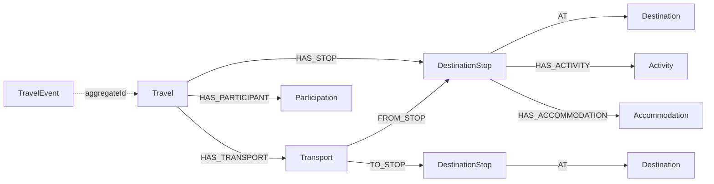

# Data model

These are planned persistence structures, not installed schemas or migrations.
All domain identifiers are server-generated UUIDs; timestamps are stored as UTC
instants, with transport input offsets retained for validating local travel dates.
Travel dates use ISO calendar dates, with inclusive duration
`endDate - startDate + 1`. Services own their transactions and storage.

| Owner | Records and constraints |
| --- | --- |
| Auth / PostgreSQL | `identity(user_id PK, normalized_email UNIQUE, password_hash, status, version)`; role assignments, hashed rotating refresh sessions, revocation state, command receipts and outbox. Identity `user_id` equals the user profile ID and bearer token subject. |
| Users / PostgreSQL | `user_profile(user_id PK, email, display_name, status, version)`; `traveler(traveler_id PK, user_id FK, given_name, family_name, date_of_birth)`; operation/step records, idempotency mappings, outbox, deletion tombstones. Roles/email reflect acknowledged auth state; normalized email is unique locally too. |
| Payments / PostgreSQL | `payment_gateway(gateway_id PK, provider, name, vault_secret_ref, enabled)`; `payment_method(payment_method_id PK, user_id, gateway_id FK, provider_reference, label, is_default, status, safe_display_metadata)`; provider operations, idempotency mappings, receipts, outbox, user deletion fences. Unique provider reference within gateway; at most one active default per user. |
| Travel / Neo4j | Travel aggregate and destination graph below; participation references user/traveler UUIDs. Command receipts, deletion fences and outbox belong to the same graph transaction. |
| Engagement / PostgreSQL | `outbox_event` and `processed_event` (migration V1, see [events](events.md)); subscriptions, cancellation history, feedback, reports with moderation history, and dashboard projections are added in Phases 3, 6 and 8. |
| Search / Elasticsearch | `travels` alias over a versioned index (`travels-v1`, ...) holding one document per published travel; a derived read model rebuilt from travel-service, never a source of truth. |

`traveler.user_id` and `payment_method.gateway_id` are same-service foreign keys.
Payment `user_id`, graph `userId`/`travelerId`, and auth `user_id` are cross-service
references, never database foreign keys. Validate them through their owner and
reconcile lifecycle changes as described in [architecture](architecture.md).
Traveler ownership, method ownership/gateway, and destination IDs are immutable;
replace a record when an ownership/provider change is required. Mutable records
include `createdAt` and `updatedAt`; concurrent writes serialize within each owner,
with last successful write winning unless an invariant causes `409`.

## Travel graph

`Travel` stores `managerId` (immutable owner user UUID, an external reference),
`name`, `description`, dates, derived duration (never client supplied), `capacity`,
`price` (decimal string, mapped to `BigDecimal`), `currency` (uppercase three letters),
`status` (`DRAFT`, `PUBLISHED`, `UNPUBLISHED`, `CANCELLED`), `version`, `createdAt` and
`updatedAt`. An index on `managerId` serves owner-scoped lists.
`DestinationStop` stores UUID, unique zero-based position within a travel, arrival
and departure dates; its destination is a shared `Destination` with name, country
code, and optional description. This graph allows ordered multi-stop itineraries,
traversal from a destination to all visiting trips, and safe shared destinations.

Activities and accommodations belong to exactly one stop. Activities contain
name, date, and optional description; accommodations contain name, address,
check-in and check-out dates. Transport belongs to exactly one travel, references
two stops in that travel, and contains mode, departure and arrival instants with
offsets. `Participation` belongs to one travel and stores the external `userId`
and `travelerId`; unique `(travelId, travelerId)` prevents duplicate enrollment.

Each label has a uniqueness constraint on its UUID. Add indexes for travel
start/end dates, destination country/name, and participation `userId`/`travelerId`.
Enforce stop position uniqueness, node ownership, required relationships, valid
date ranges, and matching participant ownership in the application transaction.
Neo4j UUID constraints alone do not enforce these aggregate invariants.

Every travel has at least one stop; positions are contiguous and match array
order, stop dates fall inside the travel period, and stop arrival order is
nondecreasing. Activities and stays fall within their stop's dates; same-day stays
are allowed. Transport arrives after departure; its endpoint-local calendar dates
fall within the referenced stops' dates and trip dates. Activities,
accommodations, and transportation arrays are required; an explicit empty array
means there are none, while omitted information is invalid. An itinerary PUT is
a complete replacement: omitted existing components are deleted, IDs supplied
must already belong to the aggregate, and new components omit their ID so the
server creates one. Reads return all component IDs.

Deleting a travel removes its stops, activities, accommodations, transport,
participation nodes, and relationships in one transaction. It preserves every
`Destination`. Deleting a referenced destination returns `409 DESTINATION_IN_USE`;
admins first replace/remove stops (retaining at least one stop on every surviving
travel), or delete the relevant trips. Deleting a user/traveler removes only
participation, leaving other participants and the full travel aggregate intact.

### Phase 2 ownership, legacy data and events

- `Travel` nodes without `managerId` are relabelled `LegacyTravelNeedsReview` at
  startup (repeat-safe). Their itinerary is kept for inspection and is invisible to
  every normal query; ownership is never backfilled.
- `TravelEvent` nodes are written in the same transaction as each mutation and carry
  `eventId`, `eventType` (`TRAVEL_CREATED`, `TRAVEL_UPDATED`, `TRAVEL_PUBLISHED`,
  `TRAVEL_UNPUBLISHED`, `TRAVEL_DELETED`), `aggregateId`, `aggregateVersion`,
  `occurredAt` and a versioned JSON `payload` (`schemaVersion` 1) holding the full
  projection. Constraints make `eventId` and `(aggregateId, aggregateVersion)` unique.
- `remainingCapacity` and `bookable` are response projections, not stored. A listing
  is bookable when `PUBLISHED`, starting after today, with places left.
- The manager page has no store of its own in Phase 2: completed and total counts come
  from travel-service statistics. `averageRating` is `null`, `recentRatings` is empty
  and `reportCount` is `0` until later phases add ratings and reports.

## States and payment data

Profiles expose `PROVISIONING`, `ACTIVE`, `DISABLED`, `DELETION_PENDING`, or `FAILED`.
Traveler records are `ACTIVE` or `DELETION_PENDING`. Payment methods expose
`PENDING`, `ACTIVE`, `DISABLED`, `DELETION_PENDING`, or `FAILED`. Operation records
expose their type, target UUID, state, timestamps, completed/current steps, trace
ID, retryability, and safe terminal error. Records being deleted remain readable
to administrators until cleanup succeeds; afterward detail reads return `404`,
while the operation remains readable for at least 30 days. List results include
pending and failed records so administrators can diagnose stalled work.

Store only provider-issued opaque references and safe display data such as brand
and last four digits. Never persist or log PAN, CVV, raw bank credentials, provider
secrets, or access/refresh tokens. Gateway settings contain a Vault path, never its
secret value; gateway reads omit even that path. Provider-controlled fields are
read-only. Admins can change local labels/default preferences; replacing underlying
funding details requires a new method. Provider flow details and any customer
approval prerequisites will be finalized against official sandbox APIs in Phase 7.

Operation and audit retention must minimize personal data. Success clears owned
personal profile/payment references while retaining only minimal IDs and safe
status metadata needed for deduplication and operational evidence. Detailed
retention and backup deletion procedures are deferred to the security/deployment
phases; no legal retention or payment-compliance certification is claimed here.
